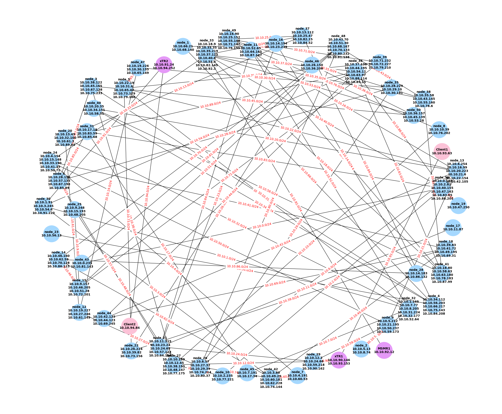

<div align="center">
<!-- Title: -->
  <h1>Docker Network Simulation</h1>
<!-- Short description: -->
  <p>一个基于 Docker 容器的网络模拟仿真工具</p>
</div>



> [!IMPORTANT]  
> 该项目还在积极开发中。

# 介绍

快速模拟随机路由拓扑，支持OSPF、LISP节点，支持注入静态路由。

## 特性

- 同时支持Flask RESTful接口和RabbitMQ API接口。
- 支持容器和网络标签，自动清理实验容器和网络。
- 基于Networkx自动绘制网络拓扑图。

# 部署

## 初始化Python

进入项目根目录，创建Python3虚拟环境：

```bash
python3 -m venv venv
```

激活虚拟环境：

```bash
source venv/bin/activate
```

安装依赖：

```bash
pip install -r requirements.txt
```

## 初始化Docker

确保docker可以正常拉取静像，请检查网络。

进入docker目录，执行：

```bash
make
```

## 使用

~~进入`configs`目录，修改配置文件：~~

- ~~`api_config.toml`：API配置文件~~
- ~~`macvlan_configs.json`：用于配置物理网卡容器直通（需修改代码引用）~~

该配置已基于使用场景进行定制。注意修改`configs/mq_config.json`文件，灵活配置mq的host地址。

使用API启动：

```bash
python3 run.py
```

独立测试：

```bash
python3 quick_test.py
```

清理：

```bash
python3 quick_clean.py
```

可以在`output`目录中观察自动生成的拓扑图和LISP配置文件。

# 接口文档

TBD

~~[2024.10.10 - beta](./app/api_documentation_zh.md)~~


# 实用工具

## Portainer

[Install Portainer CE with Docker on Linux - Portainer Documentation](https://docs.portainer.io/start/install-ce/server/docker/linux)

用于docker容器可视化。

### 部署

首先，创建 Portainer Server 将用于存储其数据库的卷：

```bash
sudo docker volume create portainer_data
```

然后，下载并安装 Portainer Server 容器：

```bash
sudo docker run -d -p 8000:8000 -p 9443:9443 --name portainer --restart=always -v /var/run/docker.sock:/var/run/docker.sock -v portainer_data:/data portainer/portainer-ce:latest
```

### 启动

访问https：

```bash
https://localhost:9443
```

## Edgeshark

[siemens/edgeshark: Discover and capture container network traffic from your comfy desktop Wireshark, using a containerized service and a Wireshark plugin. (github.com)](https://github.com/siemens/edgeshark#docker-host)

该工具通过构建容器的方式，可以顺利获取docker内部所有的容器，以及它们之间构成的网络。只需再安装一个插件程序，即可在任意docker网络中调用wireshark进行抓包分析。

### 使用方法

要仅在 localhost 上公开服务 TCP 端口 5001，请执行以下操作：

```bash
wget -q --no-cache -O - https://github.com/siemens/edgeshark/raw/main/deployments/wget/docker-compose-localhost.yaml | docker compose -f - up
```

要向远程客户端公开服务 TCP 端口 5001，请执行以下操作：

```bash
wget -q --no-cache -O - \
  https://github.com/siemens/edgeshark/raw/main/deployments/wget/docker-compose.yaml \
  | docker compose -f - up
```

最后，访问 http://localhost:5001 并开始查看容器主机虚拟网络。

如果想使用 Wireshark 实时捕获流量，需要下载[ csharg extcap](https://github.com/siemens/cshargextcap/releases) 插件并安装。在release中找到对应系统的安装文件，安装即可。

## RabbitMQ

[RabbitMQ: One broker to queue them all | RabbitMQ](https://www.rabbitmq.com/)

RabbitMQ 是一种可靠且成熟的消息传递和流媒体代理，可以轻松部署在云环境、本地和本地计算机上。

### 部署

```bash
docker run -d --name rabbitmq -p 5672:5672 -p 15672:15672 rabbitmq:management
```

### 使用

可以通过在浏览器中访问 http://localhost:15672 来访问管理插件后台页面，默认用户名/密码：`guest`/`guest`
